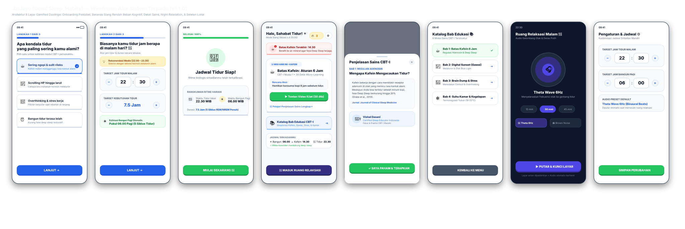

<p align="center">
  
</p>

<h1 align="center">JalJayo (Good Sleep, Habits)</h1>

<p align="center">
  <strong>Sirkadian Sleep Coach &amp; Binaural Relaxation Audio • Terapi CBT-I Mandiri</strong><br>
  Aplikasi intervensi ritme tidur sirkadian dan pereda <em>racing thoughts</em> dengan pendekatan gamifikasi taktil ala Duolingo.
</p>

<p align="center">
  <a href="https://github.com/Hesqiii/JalJayo/releases/latest"></a>
  <a href="https://developer.android.com"></a>
  <a href="https://kotlinlang.org"></a>
  <a href="https://developer.android.com/jetpack/compose"></a>
  <a href="#"></a>
  <a href="LICENSE"></a>
</p>

<p align="center">
  <a href="https://github.com/Hesqiii/JalJayo/releases/download/v1.1.1/JalJayo.apk">
    
  </a>
</p>

---

## 📱 Alur Sistem & Arsitektur 8 Layar (Wireframe v1.1.0)

Berikut adalah cetak biru arsitektur antarmuka JalJayo mulai dari langkah diagnostik awal, konfigurasi fleksibel, beranda siang rendah beban kognitif, hingga pemutar audio malam dan setelan lokal:

<p align="center">
  
</p>

> *Berkas interaktif berbasis peramban juga dapat dibuka langsung melalui [`Wireframe_JalJayo_LoFi.html`](Wireframe_JalJayo_LoFi.html).*

---

## ✨ Fitur Utama (Highlights)

### 🎧 Built-in Relaxation Player
* **AndroidX Media3 & ExoPlayer**: Berjalan stabil sebagai *Foreground Service* mandiri tanpa jeda saat layar ponsel mati (*screen-off*) atau saat aplikasi ditutup.
* **4 Pilihan Gelombang Suara Alami**:
  * **Theta Waves 6Hz**: Gelombang otak binaural untuk meredakan kecemasan dan *racing thoughts*.
  * **Brown Noise**: Derau frekuensi rendah untuk peredam suara (*sound masking*) kamar bising.
  * **Suara Hujan Alami** & **Deburan Ombak Laut**: Menghadirkan relaksasi ritmis alami.
* **Cubic Exponential Fade-Out Timer**: Pilihan durasi 15, 30, atau 45 menit. Pada 2 menit terakhir, volume suara menurun perlahan dengan formula $(1 - progress)^3$ tanpa mengejutkan otak.
* **Auto-Dismiss Notification**: Notifikasi media pemutar di *notification drawer* otomatis terhapus secara bersih saat timer selesai.

### ☀️ Sirkadian Engine & Smart Calibration
* **Dynamic Caffeine Curfew**: Menghitung batas toleransi kafein terakhir (aturan 6–8 jam sebelum tidur ideal menurut riset *Drake et al., 2013*) secara otomatis.
* **Flexible Bedtime & Wake Time**: Pemilihan jam tidur dan bangun yang fleksibel dengan interval stepper jam dan menit, dilengkapi rekomendasi jendela tidur medis (22.00 – 23.30).
* **Anchor Reminder Alarm**: Pengingat transisi tidur 45 menit sebelum waktu istirahat via Android `AlarmManager` presisi tinggi.

### 🎯 CBT-I Micro-Learning (Duolingo Style)
* **Low Cognitive Load**: Menyajikan 1 **Kartu Misi Edukasi Harian** (*Hero Quest Card*) dengan tipografi tebal, instruksi praktis ringkas, dan tombol 3D taktil.
* **Progressive Disclosure**: Penjelasan sains mendalam dan profil pakar (*Certified Sleep Educator Vishal Dasani*) dirangkum dalam modul akordeon yang rapi tanpa memenuhi layar beranda.
* **8 Modul CBT-I Terstruktur**: Menjelajahi topik kafein, paparan cahaya biru (*digital sunset*), manajemen stres (*brain dump*), hingga termoregulasi kamar tidur.
* **Sistem Streak Konsistensi (🔥)**: Membangun motivasi kebiasaan tidur teratur setiap hari.

### 🌙 True OLED Circadian Protection
* **Mode Malam Otomatis**: Layar bertransisi ke tema *True Pitch Black* (`#030712`) saat memasuki jam tidur untuk mematikan pixel layar OLED.
* **Zero Blue Light**: Nol rangsangan visual menyilaukan demi menjaga pelepasan hormon alami melatonin (*Chang et al., 2015*).

### 🔒 Yours to Keep (100% Private & Offline)
* **Tanpa Registrasi / Akun**: Langsung dapat digunakan sejak detik pertama dipasang.
* **Tanpa Pelacakan Data**: 100% pengaturan, status misi, dan streak disimpan di perangkat lokal melalui **Android Jetpack DataStore**.
* **Bebas Iklan & Langganan**: Dirancang murni sebagai sarana kesehatan tidur tanpa monetisasi intrusif.

---

## 🏛️ Arsitektur Proyek

JalJayo menerapkan prinsip **Clean Architecture & Separation of Concerns** dalam struktur multi-modul:

```
JalJayo/
├── :core                           # Modul Kotlin Murni (Bebas ketergantungan Android SDK)
│   ├── Mode.kt                     # Logika evaluasi waktu siang/malam (DAY / NIGHT)
│   ├── SleepSchedule.kt            # Algoritma sirkadian 5 siklus tidur & midnight crossing
│   ├── ComplaintPreset.kt          # Pemetaan keluhan pengguna ke preset audio relaksasi
│   └── AppClock.kt                 # Abstraksi jam sistem untuk kestabilan pengujian otomatis
│
└── :app                            # Modul Android Native & Jetpack Compose
    ├── audio/
    │   ├── PlaybackService.kt      # MediaSessionService Media3 + ExoPlayer background engine
    │   └── SleepTimer.kt           # Timer coroutine dengan kurva fade-out eksponensial
    ├── data/
    │   ├── SettingsRepository.kt   # Penyimpanan lokal DataStore Preferences (offline-first)
    │   └── ContentRepository.kt    # Parser materi edukasi CBT-I dari berkas JSON lokal
    ├── notification/
    │   ├── BedtimeScheduler.kt     # AlarmManager setAlarmClock presisi tinggi
    │   └── BedtimeReceiver.kt      # BroadcastReceiver pemicu notifikasi layar kunci
    └── ui/
        ├── components/             # Komponen taktil 3D Duolingo (Button, Card, Streak Pill)
        ├── home/                   # DayScreen (Mode Siang) & NightScreen (Mode Malam)
        ├── onboarding/             # Smart Diagnostic Micro-Onboarding (3 Langkah)
        ├── settings/               # Layar Preferensi & Pengaturan Jadwal Fleksibel
        ├── splash/                 # Splash Screen animasi dengan logo resmi
        └── theme/                  # Palet warna sirkadian & sistem tipografi
```

---

## 🛠️ Panduan Build & Menjalankan Aplikasi

### Kebutuhan Lingkungan:
* **Android Studio**: Ladybug / Meerkat atau yang lebih baru.
* **JDK**: OpenJDK 17 atau 21.
* **Android SDK**: `minSdk 28` (Android 9.0 Pie) s.d. `targetSdk 35` (Android 15).

### Kompilasi dari Terminal:
```bash
# 1. Kloning repositori
git clone https://github.com/Hesqiii/JalJayo.git
cd JalJayo

# 2. Jalankan seluruh unit & functional test
./gradlew test

# 3. Kompilasi berkas instalasi APK Debug
./gradlew assembleDebug

# Berkas APK akan terbentuk di: app/build/outputs/apk/debug/app-debug.apk
```

---

## 📚 Rujukan Ilmiah & Studi Fotobiologi

1. **Drake, C., Roehrs, T., Shambroom, J., & Roth, T. (2013).** *Caffeine effects on sleep taken 0, 3, or 6 hours before going to bed.* Journal of Clinical Sleep Medicine, 9(11), 1195-1200.
2. **Chang, A. M., Aeschbach, D., Duffy, J. F., & Czeisler, C. A. (2015).** *Evening use of light-emitting eReaders negatively affects sleep, circadian timing, and next-morning alertness.* PNAS, 112(4), 1232-1237.
3. **Walker, M. (2017).** *Why We Sleep: Unlocking the Power of Sleep and Dreams.* Scribner.
4. **Dasani, V. (2020).** *Mindful Sleep Intervention & Cognitive Behavioral Therapy for Insomnia (CBT-I) Practice.* Jakarta Sleep Center.

---

## 📄 Lisensi

Proyek ini didistribusikan di bawah lisensi terbuka **MIT License**. Silakan lihat berkas [LICENSE](LICENSE) untuk informasi hak cipta dan atribusi lengkap.
