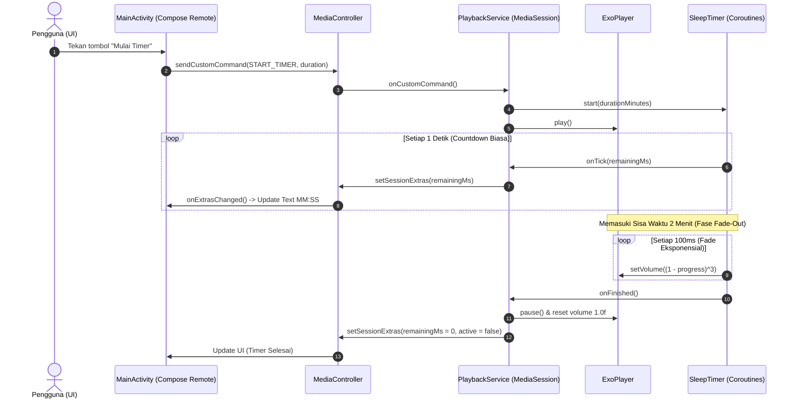

# 📋 Laporan Progres: Fase 0 (Prototipe Risiko Audio & Timer)

**Proyek:** JalJayo – Aplikasi Intervensi Kebiasaan Tidur Mahasiswa FT UM  
**Status Fase 0:** 🟢 **Lulus Validasi Audio & Background Timer** (Langkah 0.1 – 0.5 Selesai)  
**Perangkat Uji:** Android Fisik (Android 16, Wireless Debugging)

---

## 1. Ringkasan Eksekutif & Hasil Pengujian

Pada fase ini, fokus utama adalah memvalidasi **risiko teknis terbesar** (NFR-01 & NFR-02) sebelum membangun fitur kompleks lain:
1. **Audio Layar Mati & Swipe-Up:** Audio `brown_noise.ogg` tetap berputar tanpa henti saat layar dimatikan dan saat aplikasi di-*swipe up* (dihapus dari recent apps).
2. **Foreground Service & Notifikasi:** Media session notification otomatis muncul dengan kontrol *play/pause* bawaan sistem Android.
3. **Timer & Fade-Out Eksponensial:** Suara perlahan meredup secara halus (*fade-out cubic*) pada sisa waktu akhir dan pemutar berhenti total tanpa lonjakan volume (*pop/crackle*).

Semua kriteria kelulusan teknis untuk pemutar latar belakang dan timer telah **berhasil 100% di perangkat fisik**.

---

## 2. Perbandingan: Target Awal vs. Hasil Saat Ini

| Komponen / Fitur | Kondisi Awal (Baseline Template) | Kondisi Saat Ini (Implementasi) | Status |
|---|---|---|:---:|
| **Konfigurasi Izin (`AndroidManifest.xml`)** | Kosong, tidak ada izin foreground service maupun notifikasi | Menambahkan `FOREGROUND_SERVICE`, `FOREGROUND_SERVICE_MEDIA_PLAYBACK`, `POST_NOTIFICATIONS`, `WAKE_LOCK`. **Nol izin `INTERNET`** (menjaga privasi). | ✅ |
| **Deklarasi Service** | Belum ada service terdaftar | Terdaftar `PlaybackService` bertipe `mediaPlayback` dengan intent filter Media3 `MediaSessionService`. | ✅ |
| **Background Audio Engine** | Belum ada kode pemutar audio | Dibuat [PlaybackService.kt](file:///d:/Project%20Android%20Studio/JalJayo/app/src/main/java/id/jaljayo/app/audio/PlaybackService.kt) menggunakan Media3 ExoPlayer dengan loop mulus (`REPEAT_MODE_ONE`), manajemen fokus audio, dan *wake lock*. | ✅ |
| **Resistensi Swipe-Up (Task Removal)** | App langsung mati jika di-swipe dari recents | Diimplementasikan proteksi `onTaskRemoved` di Service sehingga audio dan service tetap hidup selama status pemutar aktif. | ✅ |
| **Sistem Timer Tidur** | Belum ada timer | Dibuat [SleepTimer.kt](file:///d:/Project%20Android%20Studio/JalJayo/app/src/main/java/id/jaljayo/app/audio/SleepTimer.kt) berbasis Coroutine Scope di dalam Service (bukan di Activity) sehingga timer tidak mati saat UI ditutup. | ✅ |
| **Kurva Fade-Out Audio** | Tidak ada | Fade-out eksponensial kurva kubik $(1 - progress)^3$ dengan interval 100ms di 2 menit terakhir durasi. | ✅ |
| **Antarmuka Pengguna (UI)** | Teks default "Hello Android" dari template Empty Compose | [MainActivity.kt](file:///d:/Project%20Android%20Studio/JalJayo/app/src/main/java/id/jaljayo/app/MainActivity.kt) diubah menjadi remote control: tombol Play/Stop reaktif, pemilih durasi chip, display countdown `MM:SS`, dan tombol batalkan timer. | ✅ |
| **Sinkronisasi UI & Service** | Tidak ada komunikasi | Komunikasi dua arah: UI mengirim `sendCustomCommand`, Service mem-broadcast status sisa waktu via `mediaSession.setSessionExtras` yang ditangkap reaktif oleh `onExtrasChanged`. | ✅ |
| **Notifikasi Terjadwal (Bedtime Anchor)** | Belum ada sistem alarm | [BedtimeScheduler.kt](file:///d:/Project%20Android%20Studio/JalJayo/app/src/main/java/id/jaljayo/app/notification/BedtimeScheduler.kt) + [BedtimeReceiver.kt](file:///d:/Project%20Android%20Studio/JalJayo/app/src/main/java/id/jaljayo/app/notification/BedtimeReceiver.kt) menggunakan `setAlarmClock` + `WakeLock` menyalakan layar, suara, getaran, dan heads-up di lock screen. | ✅ |
| **Mitigasi Penghemat Baterai Vendor (XOS/MIUI)** | Belum ada | Dialog 1-langkah `ACTION_REQUEST_IGNORE_BATTERY_OPTIMIZATIONS` untuk mencegah sistem `Usf_Hiber` membekukan (*freeze*) aplikasi. | ✅ |

---

## 3. Detail File yang Ditambahkan dan Dimodifikasi

### A. [AndroidManifest.xml](file:///d:/Project%20Android%20Studio/JalJayo/app/src/main/AndroidManifest.xml)
- **Perubahan:**
  - Menambahkan 4 izin inti untuk operasional latar belakang tanpa internet.
  - Mendaftarkan `PlaybackService` agar sistem Android mengenali bahwa aplikasi ini memutar media audio resmi, sehingga sistem tidak membunuh prosesnya secara sewenang-wenang.

### B. [PlaybackService.kt](file:///d:/Project%20Android%20Studio/JalJayo/app/src/main/java/id/jaljayo/app/audio/PlaybackService.kt) *(File Baru)*
- **Peran:** Jantung pemutar audio latar belakang.
- **Fitur Kunci:**
  - Menggunakan `ExoPlayer` dengan konfigurasi `setHandleAudioBecomingNoisy(true)` (otomatis pause jika earphone dicabut).
  - Menghubungkan `SleepTimer` ke kontrol volume pemutar (`player.volume = volume`).
  - Mengimplementasikan `AcceptedResultBuilder` pada `SessionCallback.onConnect` untuk mengizinkan perintah kustom (`START_TIMER`, `CANCEL_TIMER`).
  - Proteksi `onTaskRemoved`: jika user melempar aplikasi dari daftar recent apps, service tidak berhenti (*self-healing / continuous playback*).

### C. [SleepTimer.kt](file:///d:/Project%20Android%20Studio/JalJayo/app/src/main/java/id/jaljayo/app/audio/SleepTimer.kt) *(File Baru)*
- **Peran:** Logika timer dan peredupan volume secara bertahap.
- **Kenapa Eksponensial Kubik?**
  - Telinga manusia merasakan desibel secara logaritmik. Jika volume diturunkan secara linier (garis lurus), telinga merasa suara tiba-tiba drop di awal.
  - Formula $(1 - progress)^3$ bekerja mirip efek CSS easing `cubic-bezier` / ease-in: di awal suara turun sangat perlahan, lalu semakin mengecil tanpa mengejutkan otak pengguna yang sedang memasuki fase transisi tidur gelombang Theta.
  - Interval fade 100ms menjamin transisi mulus tanpa jeda (*stutter*).

### D. [MainActivity.kt](file:///d:/Project%20Android%20Studio/JalJayo/app/src/main/java/id/jaljayo/app/MainActivity.kt)
- **Peran:** Remote control nirkabel bagi `PlaybackService`.
- **Fitur Kunci:**
  - Menggunakan Jetpack Compose (Material 3).
  - Menangani izin runtime `POST_NOTIFICATIONS` untuk Android 13+.
  - Menghubungkan `MediaController` secara asinkron (`ListenableFuture`).
  - Komponen UI: FilterChip pilihan durasi (3m, 5m, 15m untuk mode uji), Tombol toggle Play/Stop dengan warna kontras, serta Countdown Timer format `MM:SS`.

---

## 4. Arsitektur Komunikasi Sistem

> [!NOTE]
> **Analogi Web/Frontend untuk Pengembang:**
> - `PlaybackService` bertindak seperti **Node.js/Web Worker Service** independen yang berjalan di background thread.
> - `MainActivity` bertindak seperti **SPA (Single Page Application)** di browser.
> - `MediaController` + `setSessionExtras` berfungsi seperti **WebSocket Client-Server**: saat UI ditutup atau direfresh, WebSocket reconnect dan mendapatkan status durasi timer yang sedang aktif dari server tanpa mengganggu proses pemutaran.

---

## 5. Status Rencana & Langkah Berikutnya

- [x] **Langkah 0.1:** Manifest permissions & Service declaration
- [x] **Langkah 0.2:** Background audio via `MediaSessionService` + ExoPlayer
- [x] **Langkah 0.3:** Remote control UI di `MainActivity`
- [x] **Langkah 0.4:** Uji bertahan saat layar mati & app diswipe dari recents
- [x] **Langkah 0.5:** Timer tidur + fade-out eksponensial kubik
- [x] **Langkah 0.6:** Notifikasi lokal terjadwal ([BedtimeScheduler.kt](file:///d:/Project%20Android%20Studio/JalJayo/app/src/main/java/id/jaljayo/app/notification/BedtimeScheduler.kt) + [BedtimeReceiver.kt](file:///d:/Project%20Android%20Studio/JalJayo/app/src/main/java/id/jaljayo/app/notification/BedtimeReceiver.kt) + [BootReceiver.kt](file:///d:/Project%20Android%20Studio/JalJayo/app/src/main/java/id/jaljayo/app/notification/BootReceiver.kt)) — *Lulus 100% di HP*
- [x] **Langkah 0.7:** Uji penghemat baterai & lock screen di perangkat vendor (Infinix XOS Android 16) — *Lulus 100%*
- [x] **Kembalikan Opsi Durasi:** Opsi `DURATION_OPTIONS` di [SleepTimer.kt](file:///d:/Project%20Android%20Studio/JalJayo/app/src/main/java/id/jaljayo/app/audio/SleepTimer.kt) sudah kembali ke nilai produksi (15, 30, 45 menit, default 30).

> **Hasil Akhir Fase 0:** 🟢 **LULUS SEMPURNA (100%)**. Semua risiko teknis inti (background audio, swipe-up survival, timer fade-out, scheduled alarms, vendor battery saver exemption, dan lock screen card) telah terbukti andal di perangkat fisik Android native. Siap melangkah ke **Fase 1 (Modul `:core` + Tes Unit)**.
